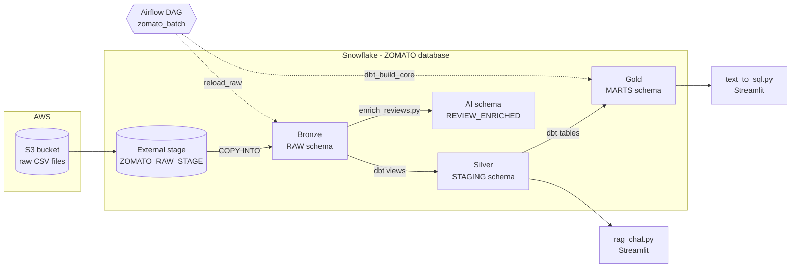

# Food Delivery Data Engineering Pipeline

An end-to-end data engineering project on a food delivery dataset (orders, restaurants, users, menus and ~300k reviews).

Raw CSV files stored in **AWS S3** are loaded into **Snowflake**, transformed with **dbt** through a **medallion architecture** (Bronze → Silver → Gold), orchestrated daily by **Apache Airflow** running in Docker, and topped with an **AI layer** (OpenAI) for review enrichment, natural-language-to-SQL and RAG chat over reviews.

| Layer | Tool |
|---|---|
| Source storage | AWS S3 |
| Warehouse | Snowflake |
| Transformation & testing | dbt (dbt-snowflake) |
| Orchestration | Apache Airflow 3 (Docker Compose, LocalExecutor) |
| AI / LLM | OpenAI `gpt-4o-mini`, `text-embedding-3-small` |
| AI apps | Python, Streamlit |

---

## Architecture



---

## Medallion architecture

The medallion architecture organises data into layers of increasing quality. Each layer has one job, so problems are easy to trace back and every layer can be rebuilt from the one before it.

### Bronze: `ZOMATO.RAW`

**Raw data, exactly as it arrived.** No cleaning, no renaming.

- The CSV files live in an **AWS S3** bucket. The Snowflake external stage `@ZOMATO.RAW.ZOMATO_RAW_STAGE` points at that bucket, and `COPY INTO` loads the files from it.
- Tables: `restaurants`, `users`, `food`, `menu`, `orders`, `order_items`, `reviews`.
- Declared to dbt as the `raw` source in [`sources.yml`](zomato/models/staging/sources.yml).
- Snowflake's load history means re-running `COPY INTO` only picks up **new** files, so loads are safe to repeat.

### Silver: `ZOMATO.STAGING`

**Cleaned, typed and standardised data, one model per source table.** Materialised as **views**.

| Model | What it does |
|---|---|
| `stg_orders` | Renames keys (`user_id` → `customer_id`, `r_id` → `restaurant_id`), extracts the city from `"area, city"` strings, derives `is_delivered` |
| `stg_order_items` | Line items per order |
| `stg_restaurants` | Casts IDs, cleans city, converts text like `'--'` ratings, `'100+ ratings'` and `'₹ 300'` into numbers with `try_to_number` / `try_to_decimal`, drops rows with non-numeric IDs |
| `stg_users` | Customer attributes |
| `stg_food`, `stg_menu` | Food items and restaurant menus |
| `stg_reviews` | Casts types, removes empty comments, adds the restaurant's city |

Tests in [`_staging.yml`](zomato/models/staging/_staging.yml) check primary keys (`unique`, `not_null`).

### Gold: `ZOMATO.MARTS`

**Business-ready star schema and aggregated marts.** Materialised as **tables**.

**Dimensions**

| Model | Description |
|---|---|
| `dim_customer` | Customers, with a derived `age_segment` (Gen Z / Millennial / Gen X / Boomer) |
| `dim_restaurants` | Restaurant name, city, cuisine, rating, cost for two |
| `dim_food` | Food items, veg / non-veg |
| `dim_date` | Calendar from 2024-01-01 to 2026-12-31 (year, month, day name, `is_weekend`), built from a generated date spine |

**Facts** are **incremental** models (`merge` on the primary key): each run processes only orders newer than the latest `order_timestamp` already loaded.

| Model | Grain |
|---|---|
| `fct_orders` | One row per order |
| `fact_order_items` | One row per item in an order |

**Marts** are pre-aggregated for dashboards and the text-to-SQL app.

| Model | Grain | Key metrics |
|---|---|---|
| `mart_daily_city_revenue` | date × city | orders, delivered orders, cancel rate, GMV, AOV |
| `mart_restaurant_performance` | restaurant | orders, revenue, avg customer rating, avg delivery time |
| `mart_delivery_sla` | city × order hour | p50 / p90 delivery time, SLA breach rate (> 30 min) |

Tests in [`_marts.yml`](zomato/models/marts/_marts.yml) check `fct_orders` keys, referential integrity to `dim_customer`, and accepted `order_status` values.

> **Schema naming:** the macro [`generate_schema_name`](zomato/macros/generate_schema_names.sql) makes dbt write to `STAGING` / `MARTS` exactly, instead of dbt's default `<target_schema>_<custom_schema>` names.

---

## Pipeline: Airflow DAG `zomato_batch`

Defined in [`airflow/dags/zomato_batch.py`](airflow/dags/zomato_batch.py) and scheduled **daily** (`@daily`, `catchup=False`).

```
reload_raw  ──►  dbt_build_core
```

1. **`reload_raw`** (`SQLExecuteQueryOperator`) runs `COPY INTO` for every RAW table from the stage, using the `snowflake_default` connection. This loads **Bronze**.
2. **`dbt_build_core`** (`BashOperator`) runs `dbt build --exclude tag:ai`. That builds and tests **Silver** and **Gold** in dependency order. Models tagged `ai` are excluded so the scheduled run never spends OpenAI tokens.

### How Airflow runs (Docker)

[`docker-compose.yaml`](airflow/docker-compose.yaml) starts Airflow 3 with:

- `postgres`: the Airflow metadata database
- `airflow-init`: migrates the database and creates the `admin` user
- `apiserver`: the UI at <http://localhost:8080>
- `scheduler`: runs DAGs
- `dag-processor`: parses DAG files (a separate component in Airflow 3)

The [`Dockerfile`](airflow/Dockerfile) extends `apache/airflow` with the Snowflake and FAB providers, and installs dbt in its **own virtualenv** (`/opt/airflow/dbt_venv`) so its dependencies never clash with Airflow's. The dbt project is mounted into the containers at `/opt/airflow/dbt/zomato`.

---

## AI folder

[`ai/`](ai/) holds three standalone Python scripts that add LLM features on top of the warehouse. They run **outside** the scheduled pipeline, so you control exactly when OpenAI is called and how much it costs.

### 1. [`enrich_reviews.py`](ai/enrich_reviews.py): review enrichment (batch)

Classifies customer reviews with `gpt-4o-mini` and writes the results back to Snowflake.

- Reads reviews from `ZOMATO.RAW.REVIEWS` that are **not yet enriched**.
- For each review, asks the model for JSON containing:
  - `sentiment_label`: positive / negative / neutral
  - `sentiment_score`: from -1.0 to 1.0
  - `topic`: food quality, delivery, pricing, service, packaging or other
  - `key_issue`: a short phrase, or null
- Inserts the results into **`ZOMATO.AI.REVIEW_ENRICHED`**, creating the schema and table if needed.
- **Cost control:** `SAMPLE_N = 5` caps each run at 5 reviews. Because already-enriched reviews are skipped, every run enriches the *next* 5 rather than all ~300k at once.

```bash
python enrich_reviews.py
```

### 2. [`text_to_sql.py`](ai/text_to_sql.py): ask your data in English (Streamlit)

Turns a plain-English question into Snowflake SQL against the **Gold** layer, runs it and shows the result.

- The prompt describes the `MARTS` tables, and the model returns `{"sql": "..."}`.
- **Safety checks** before execution: the query must start with `SELECT` / `WITH`, and it is rejected if it contains words like `drop`, `delete`, `update`, `insert` or `grant`.
- Displays the generated SQL and the result table, and draws a bar chart automatically when the result is two columns (label + number).

Example questions: *"Top 10 cities by GMV"*, *"Average delivery time by city, worst first"*, *"Cancel rate by payment method"*.

```bash
streamlit run text_to_sql.py
```

### 3. [`rag_chat.py`](ai/rag_chat.py): chat with reviews (RAG, Streamlit)

Answers questions using the text of real customer reviews (Retrieval-Augmented Generation).

1. **Load:** samples 500 reviews from `ZOMATO.STAGING.STG_REVIEWS`.
2. **Embed:** converts each review to a vector with `text-embedding-3-small`. The embeddings are cached to `review_embeddings.parquet`, so they are only computed (and paid for) once.
3. **Retrieve:** embeds the question and finds the top 5 most similar reviews by cosine similarity.
4. **Generate:** `gpt-4o-mini` answers **only** from those 5 reviews, and the app shows which reviews it used.

Example question: *"What are the most common complaints about delivery?"*

```bash
streamlit run rag_chat.py
```

### AI setup

```bash
cd ai
python -m venv venv
venv\Scripts\activate          # Windows  (macOS/Linux: source venv/bin/activate)
pip install -r requirements.txt
```

Create `ai/.env` (never commit it):

```
SNOWFLAKE_ACCOUNT=<org>-<account>
SNOWFLAKE_USER=<login name>
SNOWFLAKE_PASSWORD=<password>
SNOWFLAKE_ROLE=DBT_ROLE
SNOWFLAKE_WAREHOUSE=ZOMATO_WH
SNOWFLAKE_DATABASE=ZOMATO
SNOWFLAKE_SCHEMA=RAW
OPENAI_API_KEY=<your key>
```

> **Tip:** Set a monthly budget limit in your OpenAI account settings as a hard cap on spend.

---

## Project structure

```
.
├── airflow/
│   ├── dags/zomato_batch.py      # daily pipeline: COPY INTO → dbt build
│   ├── docker-compose.yaml       # Airflow 3 + Postgres
│   ├── Dockerfile                # Airflow image + Snowflake provider + dbt venv
│   └── .env                      # credentials (git-ignored)
├── zomato/                       # dbt project
│   ├── models/
│   │   ├── staging/              # Silver: stg_* views + sources.yml + tests
│   │   └── marts/                # Gold: dim_*, fct_*, mart_* tables + tests
│   ├── macros/generate_schema_names.sql
│   ├── dbt_project.yml
│   └── profiles.yml              # reads credentials from env vars
├── ai/                           # LLM apps (see above)
│   ├── enrich_reviews.py
│   ├── text_to_sql.py
│   ├── rag_chat.py
│   └── requirements.txt
└── data/                         # raw CSVs (git-ignored, ~2.3 GB)
```

---

## Getting started

### Prerequisites

- A Snowflake account with database `ZOMATO`, warehouse `ZOMATO_WH`, role `DBT_ROLE`, the `RAW` tables, and the external stage `@ZOMATO.RAW.ZOMATO_RAW_STAGE` pointing at the S3 bucket
- An AWS S3 bucket containing the raw CSV files, with one folder per table (`restaurants/`, `users/`, `food/`, `menu/`, `orders/`, `order_items/`, `reviews/`)
- Docker Desktop
- An OpenAI API key (only needed for the `ai/` scripts)

### 1. Run the pipeline with Airflow

Create `airflow/.env`:

```
SNOWFLAKE_ACCOUNT=<org>-<account>
SNOWFLAKE_USER=<login name>
SNOWFLAKE_PASSWORD=<password>
OPENAI_API_KEY=<your key>
```

Then:

```bash
cd airflow
docker compose build
docker compose up -d
```

Open <http://localhost:8080> (login `admin` / `admin`), unpause **`zomato_batch`** and trigger it.

### 2. Run dbt locally (optional)

`zomato/profiles.yml` reads its credentials from environment variables:

```powershell
$env:SNOWFLAKE_ACCOUNT  = "<org>-<account>"
$env:SNOWFLAKE_USER     = "<login name>"
$env:SNOWFLAKE_PASSWORD = "<password>"

cd zomato
dbt debug          # check the connection
dbt build          # run models + tests
```

### 3. Run the AI apps

See [AI setup](#ai-setup) above.
